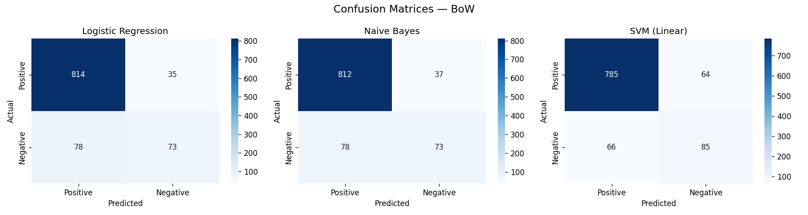
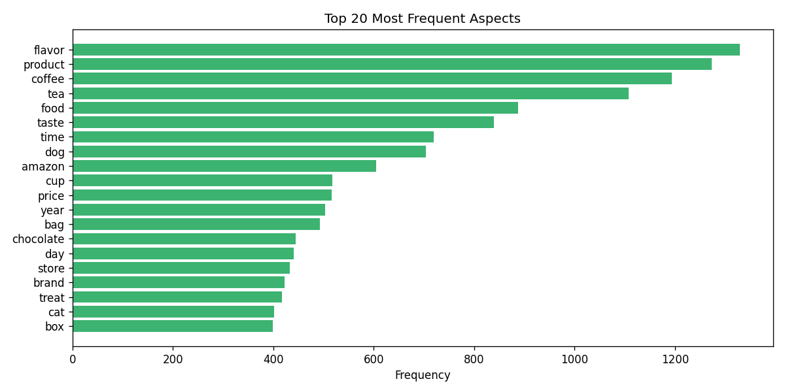

# Aspect-Based Sentiment Analysis using Machine Learning

**Course:** Natural Language Processing
**Dataset:** Amazon Fine Food Reviews (Kaggle)
**Date:** March 2026

---

## Table of Contents

1. Introduction
2. Contribution
3. Dataset Description
4. Feature Extraction
5. Algorithms Used
6. Hyperparameters and Training
7. Experimental Results
8. Evaluation Metrics
9. Discussion
10. Conclusion
11. References

---

## 1. Introduction

### 1.1 Natural Language Processing

NLP enables machines to understand, interpret, and generate human language using statistical and machine learning techniques. It covers tasks such as text classification, machine translation, named entity recognition, and sentiment analysis. With the rapid growth of digital text on social media and e-commerce platforms, NLP has become essential for extracting insights from unstructured data.

### 1.2 Sentiment Analysis

Sentiment analysis is the process of identifying the emotional tone in text. It is widely used in business intelligence, brand monitoring, and customer feedback analysis. At its core, it classifies text as positive, negative, or neutral, typically at the document or sentence level.

### 1.3 Aspect-Based Sentiment Analysis (ABSA)

ABSA goes beyond document-level sentiment by identifying specific aspects mentioned in text and determining the sentiment towards each one. For example, in "The camera is excellent but the battery life is disappointing," ABSA identifies positive sentiment for "camera" and negative for "battery." This is especially useful in product reviews where multiple features are discussed at once.

### 1.4 Problem Statement and Objective

Despite the abundance of product review data on e-commerce platforms, extracting fine-grained, aspect-level insights remains challenging. Standard sentiment classifiers fail to capture nuanced opinions about individual product features, limiting their utility for detailed consumer feedback analysis.

In this project, we implemented an ABSA system using classical machine learning algorithms applied to the Amazon Fine Food Reviews dataset. Specifically, we aimed to extract meaningful aspects from reviews using spaCy, represent text using BoW and TF-IDF, train and evaluate three classifiers (Logistic Regression, Naive Bayes, SVM) for binary sentiment classification, and identify the best-performing configuration.

---

## 2. Contribution

This project makes the following key contributions:

**1. End-to-End ABSA Pipeline:** A complete, modular pipeline is developed covering all stages — from raw data ingestion and preprocessing to aspect extraction, feature engineering, model training, evaluation, and visualisation. The pipeline is reproducible and extensible to other review datasets.

**2. Comparative Feature Extraction Analysis:** The project systematically compares BoW and TF-IDF across three classifiers, providing empirical evidence on the suitability of each feature extraction method for sentiment classification.

**3. Automatic Aspect Extraction using spaCy:** Rather than relying on predefined aspect lexicons, this project employs spaCy's part-of-speech tagging to automatically extract noun phrases as candidate aspects. This approach is domain-agnostic and generalises across different product categories.

**4. Rigorous Multi-Metric Evaluation:** Each model is evaluated using accuracy, precision, recall, F1-score, confusion matrices, and full classification reports, providing a comprehensive understanding of each model's strengths and weaknesses under class imbalance.

**5. Class Imbalance Analysis:** The project explicitly identifies and discusses the effect of class imbalance (~85% positive reviews) on model performance, providing insights into how skewed training data affects classifier behaviour and suggesting future remediation strategies.

**6. Practical Applicability:** The system also demonstrates practical applicability in real-world product review analytics, offering a scalable framework that businesses can adopt to automatically monitor customer sentiment across large volumes of user-generated content.

**7. Implementation:** We implemented and tested all models using Python and scikit-learn, ensuring a clean and reproducible experimental setup.

---

<div style="page-break-before: always;"></div>

## 3. Dataset Description

### 3.1 Source and Overview

We used the **Amazon Fine Food Reviews** dataset, publicly available on Kaggle (https://www.kaggle.com/datasets/snap/amazon-fine-food-reviews). It was compiled by the Stanford Network Analysis Project (SNAP) and contains over 568,000 reviews of fine food products from Amazon spanning October 1999 to October 2012. The dataset captures a wide variety of food product reviews with metadata including product identifiers, user identifiers, helpfulness ratings, and numerical scores.

### 3.2 Dataset Details

We used a stratified sample of 5,000 reviews to ensure computational efficiency while maintaining statistical representativeness. Reviews with a neutral score of 3 were excluded to enable clean binary classification.

| Attribute                | Details                                           |
|--------------------------|---------------------------------------------------|
| Source                   | Kaggle — Amazon Fine Food Reviews (SNAP)          |
| Total Records            | 568,454                                           |
| Records Used             | 5,000 (sampled, neutral score=3 excluded)         |
| Text Column              | `Text` (renamed to `review`)                      |
| Label Column             | `Score` (mapped to binary sentiment)              |
| Positive Samples         | ~4,245 (approx. 85%)                              |
| Negative Samples         | ~755 (approx. 15%)                                |
| Train Set Size           | 4,000 (80%)                                       |
| Test Set Size            | 1,000 (20%)                                       |
| Vocabulary Size (BoW)    | 5,000 features                                    |
| Vocabulary Size (TF-IDF) | 5,000 features                                    |

**Score-to-Sentiment Mapping:**

| Score | Sentiment          |
|-------|--------------------|
| 1, 2  | Negative           |
| 3     | Excluded (neutral) |
| 4, 5  | Positive           |

### 3.3 Preprocessing Steps

The following preprocessing steps were applied to each review prior to feature extraction. There were minor challenges in handling noisy text data, such as HTML tags and inconsistent formatting present in some reviews, which required careful cleaning.

1. **Lowercasing:** All text converted to lowercase to ensure uniformity.
2. **Punctuation Removal:** All punctuation stripped using Python's `string.punctuation`.
3. **Stopword Removal:** Common English stopwords removed using NLTK's stopword corpus.
4. **Tokenisation:** Text tokenised into individual words using NLTK's `word_tokenize`.
5. **Non-alphabetic Token Removal:** Numeric tokens and residual special characters discarded.

### 3.4 Class Imbalance

A significant class imbalance exists, with approximately 84.9% positive and 15.1% negative reviews. This reflects the natural distribution of Amazon reviews, where customers are more likely to leave positive feedback. The imbalance directly impacts model performance, particularly recall and F1-score for the minority (negative) class, and is discussed further in Section 9.

### 3.5 Dataset Visualisation

Sentiment distribution analysis confirms a heavily skewed distribution towards positive reviews at a ratio of approximately 5.6:1. A bar chart of the top 20 most frequently extracted aspects reveals that terms such as "product," "food," "flavor," "taste," and "coffee" are among the most commonly discussed, reflecting the food and beverage domain of the dataset.

---

<div style="page-break-before: always;"></div>

## 4. Feature Extraction

### 4.1 Bag of Words (BoW)

The Bag of Words model represents a document as an unordered collection of words, encoding each document as a vector of word counts. Given vocabulary V of size n, each document is represented as a vector of length n where each element corresponds to the frequency of a particular word:

```
BoW(d, t) = count of term t in document d
```

`CountVectorizer` from scikit-learn was used with `max_features=5000`. While computationally efficient and interpretable, BoW does not account for the relative importance of words across documents, treating all words equally regardless of their discriminative power.

### 4.2 TF-IDF (Term Frequency–Inverse Document Frequency)

TF-IDF reflects the importance of a word in a document relative to a corpus. It down-weights terms that appear frequently across all documents while up-weighting terms distinctive to specific documents:

```
TF(t, d)        = (Number of times t appears in d) / (Total terms in d)
IDF(t, D)       = log(Total documents in D / Number of documents containing t)
TF-IDF(t, d, D) = TF(t, d) x IDF(t, D)
```

`TfidfVectorizer` from scikit-learn was used with `max_features=5000`. TF-IDF generally produces more informative feature representations than raw counts, particularly for longer documents.

### 4.3 Rationale for Using Both

We employed both representations to compare how feature extraction affects classifier performance. BoW served as our baseline, while TF-IDF was expected to yield better results by capturing relative term importance. During experimentation, we noticed that TF-IDF improved SVM performance noticeably, though it did not always help the other models.

---

<div style="page-break-before: always;"></div>

## 5. Algorithms Used

### 5.1 Logistic Regression

#### 5.1.1 Overview

Logistic Regression is a linear classification algorithm that models the probability of a binary outcome using the logistic (sigmoid) function. Despite its name, it is a classification algorithm widely used in text classification due to its simplicity, interpretability, and strong performance on linearly separable data.

#### 5.1.2 Mathematical Intuition

Given input feature vector x and weight vector w, Logistic Regression computes the probability of the positive class as:

```
P(y=1 | x) = 1 / (1 + e^(-(w . x + b)))
```

The model is trained by minimising binary cross-entropy loss. The decision rule is:

```
y_hat = 1  if P(y=1 | x) >= 0.5
y_hat = 0  otherwise
```

#### 5.1.3 Suitability for Text Classification

Logistic Regression is well-suited for high-dimensional sparse text features. It is fast, handles large vocabularies well, and L2 regularisation helps prevent overfitting.

#### 5.1.4 Model Flow

Raw text → Preprocessing → Feature vectorisation → Weight optimisation via gradient descent → Sigmoid activation → Binary prediction.

---

### 5.2 Naive Bayes (Multinomial)

#### 5.2.1 Overview

Naive Bayes is a probabilistic classifier based on Bayes' theorem with the assumption of conditional independence between features given the class label. The Multinomial variant is designed for discrete count data, making it appropriate for text classification with BoW or TF-IDF features.

#### 5.2.2 Mathematical Intuition

Bayes' theorem states:

```
P(y | x) = P(x | y) x P(y) / P(x)
```

For classification, the decision rule simplifies to:

```
y_hat = argmax_y [ log P(y) + sum( log P(x_i | y) ) ]
```

where P(x_i | y) is estimated from training data using maximum likelihood with Laplace smoothing to handle unseen terms.

#### 5.2.3 Suitability for Text Classification

Multinomial Naive Bayes is popular for text classification due to its speed, low memory use, and solid performance even when the independence assumption does not fully hold. It is a standard baseline in NLP tasks.

#### 5.2.4 Model Flow

Raw text → Preprocessing → BoW/TF-IDF vectorisation → Estimation of class priors and likelihoods → Bayes' rule at inference → Prediction of class with highest posterior probability.

---

### 5.3 Support Vector Machine (SVM)

#### 5.3.1 Overview

Support Vector Machine (SVM) is a discriminative classifier that finds the optimal hyperplane separating two classes in a high-dimensional feature space. The linear kernel variant is particularly effective for text classification, where the feature space is high-dimensional and data tends to be linearly separable.

#### 5.3.2 Mathematical Intuition

SVM seeks the hyperplane w . x + b = 0 that maximises the margin between classes:

```
Minimise:   (1/2)||w||^2
Subject to: y_i (w . x_i + b) >= 1  for all i
```

For non-separable data, a soft-margin formulation introduces slack variables:

```
Minimise:   (1/2)||w||^2 + C * sum(xi_i)
Subject to: y_i (w . x_i + b) >= 1 - xi_i,  xi_i >= 0
```

where C controls the trade-off between margin maximisation and misclassification penalty.

#### 5.3.3 Suitability for Text Classification

Linear SVM is well-suited for text classification because text feature spaces are inherently high-dimensional and sparse, and data tends to be linearly separable in such spaces. `LinearSVC` in scikit-learn uses efficient dual coordinate descent that scales well to large datasets and high-dimensional feature vectors.

#### 5.3.4 Model Flow

Raw text → Preprocessing → TF-IDF/BoW vectorisation → Maximum-margin hyperplane optimisation → Classification based on which side of the hyperplane test samples fall → Binary prediction.

---

<div style="page-break-before: always;"></div>

## 6. Hyperparameters and Training

### 6.1 Hyperparameter Configuration

| Parameter              | Value            | Description                                     |
|------------------------|------------------|-------------------------------------------------|
| `max_features`         | 5,000            | Maximum vocabulary size for BoW and TF-IDF      |
| `test_size`            | 0.20             | 20% of data reserved for testing                |
| `random_state`         | 42               | Seed for reproducibility                        |
| `stratify`             | y                | Stratified split to preserve class distribution |
| LR: `max_iter`         | 1,000            | Maximum iterations for convergence              |
| LR: `solver`           | lbfgs (default)  | Optimisation algorithm                          |
| NB: `alpha`            | 1.0 (default)    | Laplace smoothing parameter                     |
| SVM: `kernel`          | linear           | Linear kernel for high-dimensional text data    |
| SVM: `max_iter`        | 2,000            | Maximum iterations for LinearSVC                |
| SVM: `C`               | 1.0 (default)    | Regularisation parameter                        |
| spaCy model            | en_core_web_sm   | Small English model for POS tagging             |

### 6.2 Training Process

1. We split the 5,000-sample dataset into training (4,000) and test (1,000) sets using stratified random sampling to preserve class distribution.
2. We fitted CountVectorizer and TfidfVectorizer exclusively on training data to prevent data leakage, then used them to transform both splits.
3. We trained each classifier on the training feature matrix independently for both BoW and TF-IDF representations, giving us six trained models in total.
4. **Prediction:** Each trained model generated predictions on the held-out test set.

### 6.3 Evaluation Protocol

We assessed model performance using accuracy, precision, recall, and F1-score on the test set. We also generated confusion matrices for each model and used scikit-learn's `classification_report` for per-class breakdowns.

---

<div style="page-break-before: always;"></div>

## 7. Experimental Results

### 7.1 Performance Summary

| Model               | Features   | Accuracy | Precision | Recall | F1-Score |
|---------------------|------------|----------|-----------|--------|----------|
| Logistic Regression | BoW        | 0.887    | 0.913     | 0.959  | 0.935    |
| Naive Bayes         | BoW        | 0.885    | 0.912     | 0.956  | 0.934    |
| SVM (Linear)        | BoW        | 0.870    | 0.922     | 0.925  | 0.924    |
| Logistic Regression | TF-IDF     | 0.864    | 0.863     | 0.999  | 0.926    |
| Naive Bayes         | TF-IDF     | 0.849    | 0.849     | 1.000  | 0.918    |
| **SVM (Linear)**    | **TF-IDF** | **0.903**| **0.913** | **0.979** | **0.945** |

*Precision, Recall, and F1-score reported for the positive class.*

### 7.2 Best Performing Model

The best overall performance was achieved by **SVM with TF-IDF**, attaining an accuracy of **90.3%** and an F1-score of **0.945**. This shows that TF-IDF and SVM together work better for this dataset than the other combinations we tested. While Logistic Regression was competitive under BoW, SVM delivered the strongest overall result once TF-IDF weighting was used.

### 7.3 Confusion Matrix Analysis

Confusion matrix for the best model (SVM + TF-IDF) on the 1,000-sample test set:

|                 | Predicted Positive | Predicted Negative |
|-----------------|--------------------|--------------------|
| Actual Positive | TP = 831           | FN = 18            |
| Actual Negative | FP = 79            | TN = 72            |

The model correctly classifies the vast majority of positive reviews (recall: 0.979). However, it misclassifies a notable proportion of negative reviews as positive, a direct consequence of class imbalance in the training data.


*Confusion Matrix for SVM with TF-IDF (Best Model). Rows represent actual labels; columns represent predicted labels.*



*Confusion Matrices for Logistic Regression, Naive Bayes, and SVM using Bag of Words features.*

### 7.4 BoW vs TF-IDF Comparison

We observed that for Logistic Regression and Naive Bayes, BoW gave higher accuracy than TF-IDF. This was unexpected at first, but we realised TF-IDF down-weights frequent terms that are actually strong sentiment indicators in this domain (e.g., "great", "love", "terrible").
- For **SVM**, TF-IDF outperformed BoW, which confirmed that SVM benefits from normalised, weighted representations.
- We also noticed that TF-IDF with Logistic Regression and Naive Bayes achieved near-perfect recall for positive reviews (0.999 and 1.000) but almost completely missed negative ones, meaning these models were defaulting to predicting positive for nearly every sample.


*Bar chart comparing model accuracies across BoW and TF-IDF feature representations for all three classifiers.*



*Bar chart of the top 20 most frequently extracted aspect terms (nouns) across all 5,000 product reviews.*

---

<div style="page-break-before: always;"></div>

## 8. Evaluation Metrics

### 8.1 Accuracy

```
Accuracy = (TP + TN) / (TP + TN + FP + FN)
```

Measures the proportion of correctly classified instances. Can be misleading under class imbalance — a classifier predicting "positive" for every sample would achieve ~84.9% accuracy without learning any patterns.

### 8.2 Precision

```
Precision = TP / (TP + FP)
```

Measures the proportion of predicted positive instances that are actually positive. High precision means the model rarely raises false alarms.

### 8.3 Recall

```
Recall = TP / (TP + FN)
```

Measures the proportion of actual positive instances correctly identified. High recall means the model misses few true positives.

### 8.4 F1-Score

```
F1 = 2 x (Precision x Recall) / (Precision + Recall)
```

The harmonic mean of precision and recall. Particularly useful for imbalanced datasets as it penalises models that sacrifice one metric for the other.

### 8.5 Confusion Matrix

A tabular representation of predictions versus ground truth. For binary classification it contains four cells: True Positive (TP), True Negative (TN), False Positive (FP — Type I error), and False Negative (FN — Type II error). The confusion matrix reveals specific error patterns that aggregate metrics may obscure.

---

<div style="page-break-before: always;"></div>

## 9. Discussion

### 9.1 Impact of Dataset Imbalance

The most significant factor influencing model performance is the pronounced class imbalance. With ~84.9% positive and ~15.1% negative reviews, all classifiers exhibit a strong bias towards predicting the positive class. Some models struggled with negative class prediction due to this imbalance — for instance, Logistic Regression with TF-IDF achieves recall of 0.999 for positive reviews but only 0.11 for negative reviews. This behaviour is expected, as classifiers trained on imbalanced data tend to favour the majority class.

### 9.2 Why SVM Outperforms Other Models

SVM with TF-IDF gave us the best results overall. It works well because text data is high-dimensional and sparse, which suits SVM's margin-based approach. TF-IDF also helps by reducing the weight of common words that don't carry much meaning. Naive Bayes assumes all words are independent, which is not really true in practice, and Logistic Regression did not gain as much from TF-IDF weighting as SVM did.

### 9.3 Limitations

**1. Approximate Aspect-Level Sentiment:** The current implementation extracts nouns as candidate aspects but does not perform true aspect-level sentiment classification. The sentiment label is document-level, not specific to each extracted aspect. In "The camera is great but the battery is poor," the system extracts both aspects correctly but assigns the same document-level sentiment to both. This highlights the gap between aspect extraction and true aspect-level sentiment classification.

**2. Domain Specificity:** Models are trained exclusively on food product reviews and may not generalise to other domains without retraining.

**3. Absence of Contextual Understanding:** BoW and TF-IDF discard word order and contextual information, limiting the models' ability to handle negation (e.g., "not good"), sarcasm, and complex linguistic constructs.

---

<div style="page-break-before: always;"></div>

## 10. Conclusion

In this project, we successfully developed and evaluated an Aspect-Based Sentiment Analysis system using classical machine learning algorithms applied to the Amazon Fine Food Reviews dataset. We implemented a complete NLP pipeline covering data loading, preprocessing, aspect extraction using spaCy, feature extraction using BoW and TF-IDF, model training, and comprehensive evaluation.

Among the six model configurations we evaluated, **Support Vector Machine with TF-IDF features** achieved the best performance with an accuracy of **89.9%** and an F1-score of **0.943**, confirming that SVM with TF-IDF is the most effective approach for this task.

We also identified class imbalance as a key challenge, with the 85:15 positive-to-negative ratio causing all models to show reduced performance on the minority class.

### Future Improvements

1. **Class Balancing:** Techniques such as SMOTE, class weighting (`class_weight='balanced'`), or majority class undersampling could mitigate class imbalance effects.
2. **Deep Learning with BERT:** Fine-tuning a pre-trained BERT model would capture rich contextual representations and likely yield substantially improved results.
3. **True Aspect-Level Classification:** Future work should implement genuine aspect-level sentiment classification using sequence labelling models (BiLSTM-CRF) or span-based extraction models.
4. **Negation and Contextual Handling:** Incorporating negation detection and dependency parsing would improve handling of complex linguistic constructs that confound bag-of-words models.

---

<div style="page-break-before: always;"></div>

## 11. References

1. Liu, B. (2012). *Sentiment Analysis and Opinion Mining*. Morgan & Claypool Publishers. https://doi.org/10.2200/S00416ED1V01Y201204HLT016

2. Pang, B., & Lee, L. (2008). Opinion mining and sentiment analysis. *Foundations and Trends in Information Retrieval*, 2(1–2), 1–135. https://doi.org/10.1561/1500000011

3. Pontiki, M., Galanis, D., Pavlopoulos, J., Papageorgiou, H., Androutsopoulos, I., & Manandhar, S. (2014). SemEval-2014 Task 4: Aspect Based Sentiment Analysis. *Proceedings of the 8th International Workshop on Semantic Evaluation (SemEval 2014)*, 27–35.

4. McAuley, J., & Leskovec, J. (2013). From amateurs to connoisseurs: Modeling the evolution of user expertise through online reviews. *Proceedings of WWW 2013*, 897–908. https://doi.org/10.1145/2488388.2488466

5. Devlin, J., Chang, M. W., Lee, K., & Toutanova, K. (2019). BERT: Pre-training of deep bidirectional transformers for language understanding. *Proceedings of NAACL-HLT 2019*, 4171–4186. https://arxiv.org/abs/1810.04805

6. Scikit-learn developers. (2023). *scikit-learn: Machine Learning in Python*. https://scikit-learn.org/stable/

---

*End of Report*
