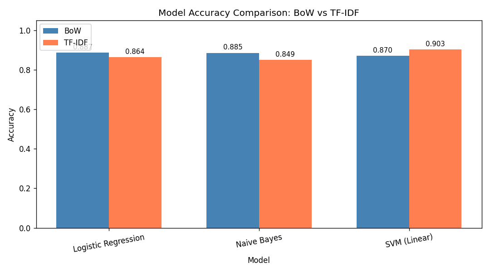
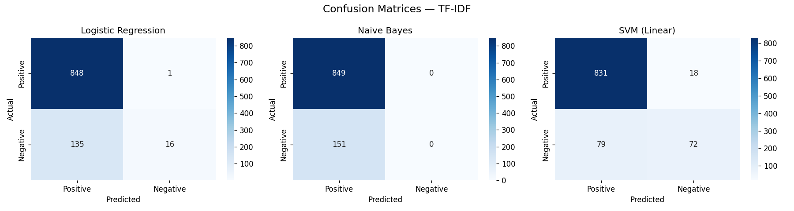

# Aspect-Based Sentiment Analysis on Amazon Fine Food Reviews

This repository presents a classical NLP and machine learning pipeline for sentiment analysis on the Amazon Fine Food Reviews dataset. The project combines text preprocessing with NLTK, noun-based aspect extraction with spaCy, feature engineering with Bag of Words and TF-IDF, and sentiment classification using Logistic Regression, Naive Bayes, and Linear SVM.

While the project extracts aspect terms from reviews, the classification stage remains document-level binary sentiment classification. In other words, it identifies candidate aspects from the text, but it does not yet assign a separate sentiment label to each aspect.

## Project Highlights

- End-to-end NLP workflow from raw review text to evaluation plots
- Text preprocessing with tokenization, stopword removal, and normalization
- Automatic aspect extraction using spaCy noun and proper noun detection
- Comparative evaluation of BoW and TF-IDF representations
- Classification with Logistic Regression, Multinomial Naive Bayes, and Linear SVM
- Leakage-free train/test evaluation with confusion matrices and summary visualizations

## Dataset

The project uses the Amazon Fine Food Reviews dataset from Kaggle:

https://www.kaggle.com/datasets/snap/amazon-fine-food-reviews

Expected local file:

- `Reviews.csv`

The script loads the dataset, keeps the `Text` and `Score` columns, removes neutral reviews with score `3`, and maps the remaining labels into:

- `1-2` -> `negative`
- `4-5` -> `positive`

`Reviews.csv` is intentionally not tracked in Git because it is too large for a normal GitHub repository.

## Methodology

The pipeline implemented in [`absa_project.py`](./absa_project.py) follows these steps:

1. Load and sample the dataset for efficient experimentation.
2. Clean review text using lowercase normalization, punctuation removal, tokenization, and stopword removal.
3. Extract candidate aspects from each review using spaCy part-of-speech tagging.
4. Split the cleaned text into train and test sets.
5. Fit `CountVectorizer` and `TfidfVectorizer` only on the training split.
6. Train three classifiers on both feature representations.
7. Evaluate performance using accuracy, precision, recall, F1-score, and confusion matrices.
8. Save plots for model comparison and aspect frequency analysis.

## Repository Structure

- [`absa_project.py`](./absa_project.py): Main training and evaluation script
- [`ABSA_Academic_Report.md`](./ABSA_Academic_Report.md): Full written report
- [`accuracy_comparison.png`](./accuracy_comparison.png): Accuracy comparison across models
- [`confusion_matrix_bow.png`](./confusion_matrix_bow.png): Confusion matrices for BoW-based models
- [`confusion_matrix_tf-idf.png`](./confusion_matrix_tf-idf.png): Confusion matrices for TF-IDF-based models
- [`top_aspects.png`](./top_aspects.png): Most frequent extracted aspect terms

## Installation

Install the required Python packages:

```bash
pip install pandas numpy nltk spacy matplotlib seaborn scikit-learn
python -m spacy download en_core_web_sm
```

## Usage

Place `Reviews.csv` in the project root, then run:

```bash
python absa_project.py
```

The script will:

- sample 5,000 reviews
- remove neutral-class samples
- preprocess and extract aspects
- train and evaluate six model configurations
- save output plots in the project directory

## Experimental Results

The current leakage-free evaluation results are:

| Model | Features | Accuracy | Precision | Recall | F1-Score |
|-------|----------|----------|-----------|--------|----------|
| Logistic Regression | BoW | 0.887 | 0.913 | 0.959 | 0.935 |
| Naive Bayes | BoW | 0.885 | 0.912 | 0.956 | 0.934 |
| SVM (Linear) | BoW | 0.870 | 0.922 | 0.925 | 0.924 |
| Logistic Regression | TF-IDF | 0.864 | 0.863 | 0.999 | 0.926 |
| Naive Bayes | TF-IDF | 0.849 | 0.849 | 1.000 | 0.918 |
| **SVM (Linear)** | **TF-IDF** | **0.903** | **0.913** | **0.979** | **0.945** |

Precision, recall, and F1-score are reported for the positive class.

## Visual Outputs

### Accuracy Comparison



### Confusion Matrices for TF-IDF Models



## Limitations

- Aspect extraction is based on noun detection and does not perform true aspect-level sentiment labeling.
- The project uses classical sparse features, so contextual language understanding is limited.
- The dataset is heavily imbalanced toward positive reviews, which affects minority-class performance.
- The dataset domain is food-product reviews, so cross-domain generalization is limited.

## Future Improvements

- Introduce class balancing strategies such as class weighting or resampling
- Move from document-level sentiment to true aspect-level sentiment assignment
- Explore contextual embeddings and transformer-based models such as BERT
- Improve aspect extraction with dependency parsing or sequence labeling approaches

## Git Notes

The repository keeps the following files local and excludes them from Git via [`.gitignore`](./.gitignore):

- `Reviews.csv`
- `database.sqlite`
- `hashes.txt`
- `__pycache__/`

This keeps the GitHub repository lightweight while allowing the full dataset and local scratch files to remain on your machine.
